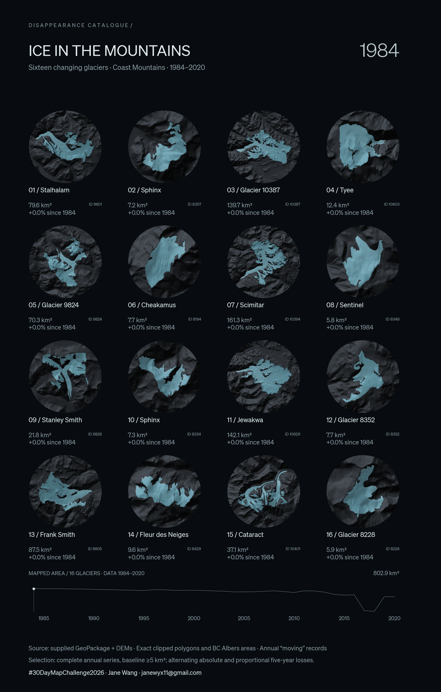
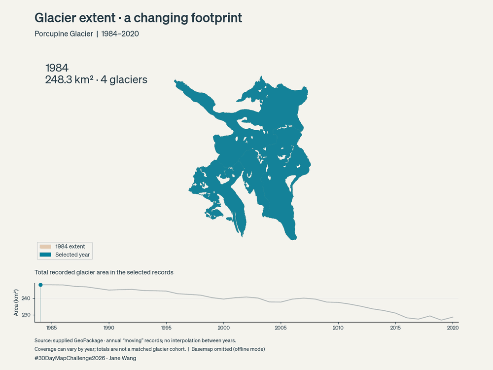
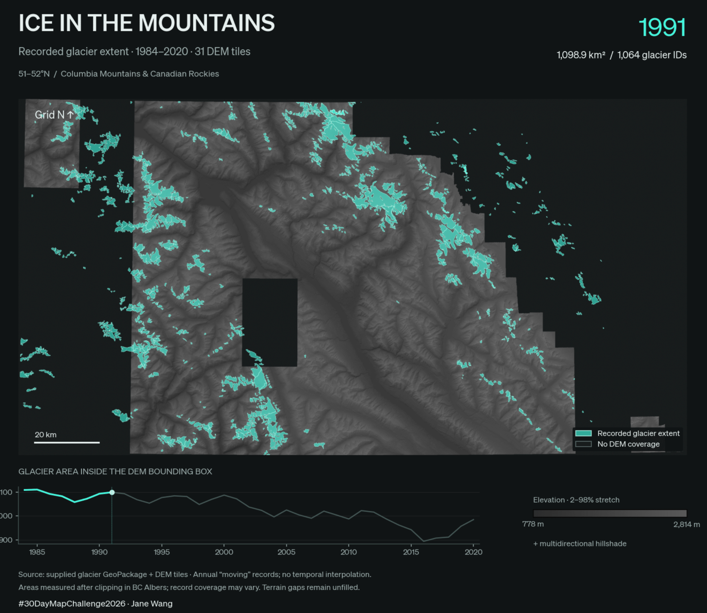
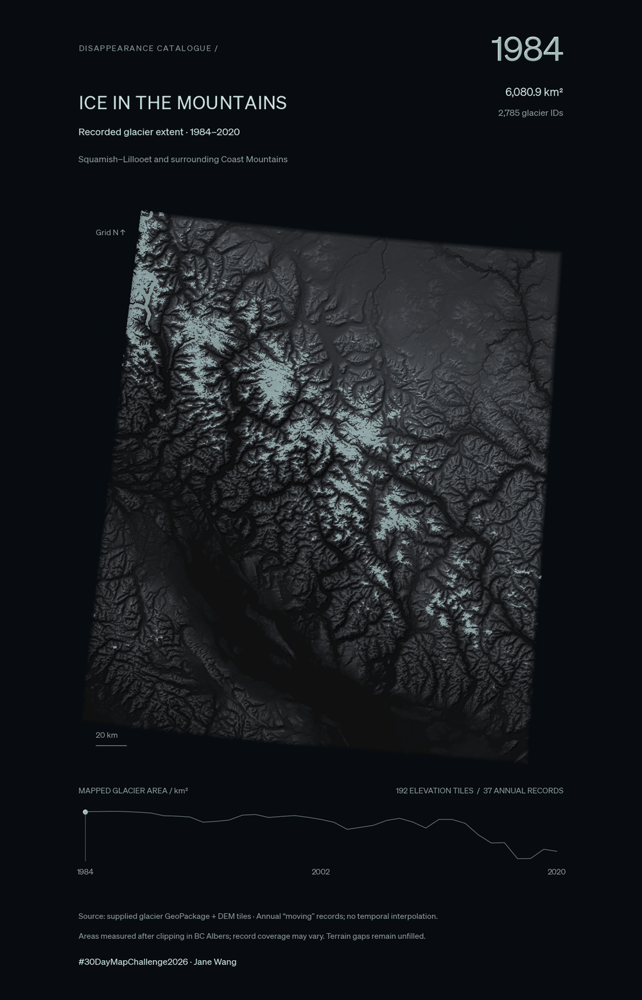
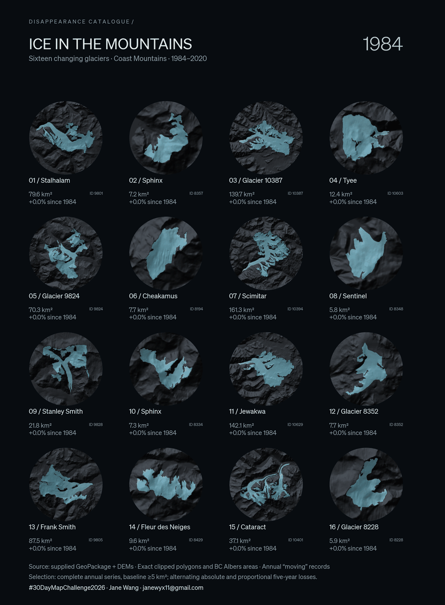

# Day 10 · Disappearance catalogue

**Ice in the mountains — a human-in-the-loop map study.**  
Jane Wang × Codex · 10 November 2026

> **Jane · Creative brief**  
> "**Today’s objective:** Today's objective is to explore how far I can develop a glacier visualization through prompting alone, without writing the implementation code myself.   Using annual glacier outlines from the Coast Mountains and digital elevation data, I want to visualize changing glacier extent between 1984 and 2020.  Start with an animated map, then explore how terrain, lighting, scale, and composition can make these changes more legible. Ultimately, I'd like to isolate sixteen glaciers with substantial recorded changes and present them as a comparative catalogue, connected by a shared area timeline.  Throughout the process, preserve the recorded glacier geometries and measurements. The visual effects should enhance interpretation without altering the underlying data."

[High-resolution still](outputs/glacier_specimens.png)

## The conversation behind the plate

*Prompt excerpts are shortened. These are saved milestones, not every intermediate render; the geographic coverage also grew during the session.*

<strong>01 / Start with time</strong>

> **Jane · Initial exploration**  
> “Start by showcasing the time series of glacier extent using the annual polygon records.  I'd like to see how the outlines change between 1984 and 2020, with a fixed map extent so the glacier doesn't move around between frames.”

**Codex →** Inspected the GeoPackage and built an annual outline animation. The prompt put recorded extent first, so each frame uses that year's geometry and keeps the map view fixed. The first saved example uses Porcupine Glacier to test whether an early outline and an area timeline make the changes easy to follow.

<strong>02 / Give the ice a landscape</strong>

> **Jane · Terrain and contrast**  
> “The glacier outlines alone aren't giving me enough geographical context. I'd like to introduce elevation data and make the terrain an important part of the composition.  Use a dark DEM background with pronounced mountain relief, then overlay the glacier polygons in bright turquoise. Make the ice semi-transparent and luminous so it stands out without completely obscuring the terrain underneath.  Let's expand beyond the single glacier and use the combined elevation coverage as our study window. Keep the year and area timeline visible, and don't remove glaciers simply because the DEM is missing in some places.  I want the map to feel more atmospheric, but the glacier extents still need to come from the actual records.”

**Codex →** The first terrain draft used 31 elevation tiles across the Columbia Mountains and Canadian Rockies. Bright turquoise ice stood out against grey hillshade, while gaps in the terrain mosaic remained visible. The large year and area timeline were already in place, alongside a boxed legend, an elevation ramp, and a scale bar.

Jane asked to use the combined elevation bounds as the study window. That kept glaciers visible where elevation coverage was missing, while the translucent fill let relief show through wherever the two layers overlapped.

<strong>03 / From map to specimen plate</strong>

> **Jane · Editorial art direction**  
> “I want to move away from the appearance of a conventional GIS export and toward an editorial scientific specimen plate.  The DEM should feel like one continuous mountain surface rather than a collection of raster tiles. Darken the valleys substantially, keep the ridges in cool graphite, and use a consistent elevation stretch and hillshade treatment across the mosaic. Soften the glacier colour from saturated turquoise toward frosted cyan. Remove the boxed legend and the DEM 2–98% elevation-stretch ramp; they're making the composition feel too technical.”

**Codex →** The *Glacier Anatomy* reference shifted the composition toward a portrait catalogue plate. Jane asked for terrain that felt like one continuous mountain surface, which guided the use of a shared tonal stretch across the mosaic and a near-black background for gaps in coverage. A small tracked catalogue heading and generous margins gave the terrain room to breathe. The relief deepened to cool graphite and the ice softened from turquoise to frosted cyan.

The boxed legend and elevation ramp came out. The year and area stayed prominent, and the timeline became a thin sparkline with a single marker for the selected year. Jane reserved pale cyan for the ice and year, with quieter type for everything else. This version also moved the study window to Squamish–Lillooet and the surrounding Coast Mountains.

Removed polygon strokes. Translucent raster ice and soft annual-change bloom let the mountain surface show through.

Jane distinguished the frost within the current footprint from the light that marks change. The inner bloom stays inside the ice, while a separate halo follows the places where the current and previous footprints differ.

<strong>05 / Sixteen moving specimens</strong>

> **Jane · Change of scale**  
> “The regional map is obscuring the very changes I'm trying to communicate. Select sixteen (arranged in a 4 × 4 grid) with particularly substantial recorded changes and give each glacier its own circular terrain view. Keep each specimen's camera and geographic extent fixed throughout the animation.  The circles don't need to share the same geographic scale, but each glacier must remain comparable with itself through time. Show the glacier name, ID, area, and percentage change since 1984 beneath each specimen. Keep the typography restrained and the terrain treatment consistent.”

**Codex →** Selected sixteen complete glacier series, fixed each circular view, and added directional ice lighting. Further prompts refined annual comparisons, pale-blue and subaqueous tones, larger captions, a thinner year, and the signature.

Jane wanted both broad icefield-like forms and smaller glaciers with visible change, so the selection balanced absolute and proportional area loss. The final prompt brought back the shared timeline, with five-year tick labels to orient readers as the panels advance annually.

## What stayed scientific

Each frame uses the recorded annual polygons, 1984–2020. Areas come from exact clipped geometry in BC Albers; lighting and bloom are display effects. The final timeline sums only the sixteen selected IDs. Circle scales vary, and the selection favours dramatic recorded change rather than a representative sample. Annual records labelled “moving” may reflect processing; the graphic does not establish independently observed annual mass loss.

## Reflection · Human in the loop

The most consequential change in this project was not a rendering technique. It was a decision about scale and visual communication.

The initial regional animation was technically functional, but the geographic extent made individual changes difficult to perceive. Additional terrain detail, contrast, and luminosity improved the visual treatment without resolving that fundamental problem.

The final pivot to sixteen circular specimens came from recognizing that the map needed a different visual structure, not simply more styling.

This is where I found the human-in-the-loop workflow most valuable: using AI to accelerate implementation and experimentation while retaining responsibility for the analytical framing, cartographic judgment, art direction, and critical review.

## Data and attribution

Glacier data: [source publication supplied with the dataset](https://www.sciencedirect.com/science/article/pii/S0034425721005824). Terrain: [GeoBC CDED elevation data](https://catalogue.data.gov.bc.ca/dataset/digital-elevation-model-for-british-columbia-cded-1-250-000), courtesy of the Province of British Columbia, under the Open Government Licence – British Columbia.

This entry shares the visual process and exported graphics. The large datasets and generation code remain local.

#30DayMapChallenge2026 · Jane Wang · janewyx11@gmail.com
