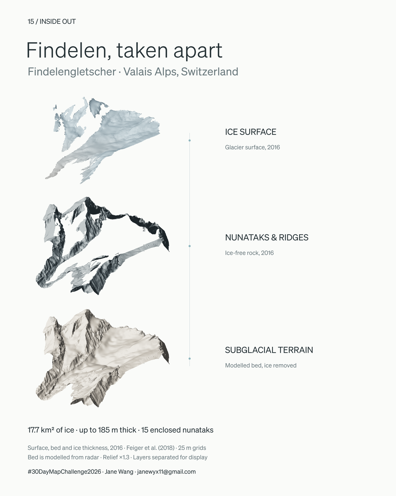

# Day 15 · Inside out — Findelen, taken apart

This plate shows Findelengletscher, in the Valais Alps of Switzerland, separated into three layers: the ice surface, the ice-free rock that rises through it, and the terrain beneath the ice. All three layers come from a single model of surface elevation, bed elevation and ice thickness, published by Feiger, Huss, Leinss, Sold & Farinotti (2018). Because the three grids share one 25 m spacing, the layers can be compared directly.

## Plate · Findelen, taken apart

Every layer is drawn with the same camera, which keeps the glacier outline aligned from one layer to the next. The layers differ only in their height on the page. Each one is raised just enough to clear the layer below it, so the spacing between them stays even.

The bed is the least certain of the three layers. It comes from radar measurements combined with modelling, rather than from direct observation of the whole glacier floor. The plate counts 15 enclosed nunataks: rock islands of at least 1,250 m² that are fully surrounded by ice.

The plate is built in a [notebook](notebooks/findelen_anatomy.ipynb), so each step can be run and inspected on its own. The steps are loading the data, checking that the grids agree, setting up the camera, shading each layer, stacking the layers, combining them into one image, and drawing the plate. Each step ends with a small working figure.

- `notebooks/findelen_anatomy.ipynb` runs the full process from top to bottom.
- `scripts/anatomy_functions.py` holds the rendering functions: resampling, shading, the camera, layer stacking and compositing.
- `scripts/anatomy_config.yaml` holds the settings for the camera, layout, type sizes and colours. To restyle the plate, edit this file rather than the code.

The notebook writes three files: `outputs/findelen_anatomy.png` (3900 × 4875 px, 300 DPI), `outputs/findelen_anatomy_preview.png` (1300 px wide) and `outputs/findelen_anatomy_metadata.json`.

## Source data

The datasets used in this study come from Feiger, Huss, Leinss, Sold & Farinotti (2018), *The bedrock topography of Gries- and Findelengletscher* ([study](https://doi.org/10.5194/gh-73-1-2018), [data supplement](https://gh.copernicus.org/articles/73/1/2018/gh-73-1-2018-supplement.zip)). The publication is licensed CC BY 3.0, and the supplement's attribution and terms should be retained.

The wider, dataset search for this day is documented in [`data/README.md`](data/README.md). It covers the other glaciers considered, what was downloaded and what was only catalogued, licensing and checksums, and the reasons each candidate was used or set aside.
