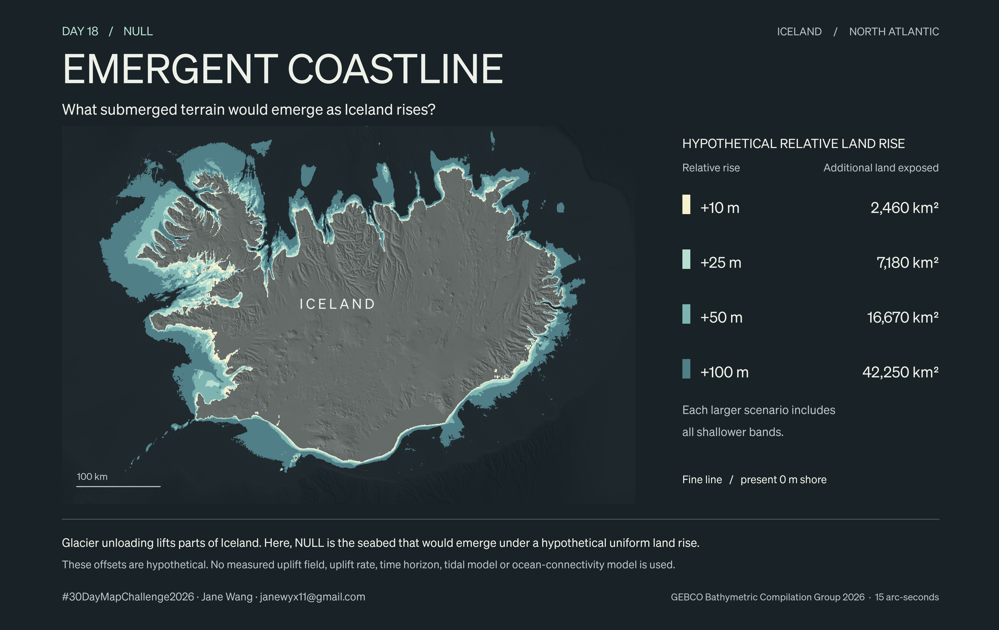

# Day 18 · NULL · Emergent coastline

Parts of Iceland are rising as glaciers lose mass and the crust responds to the lighter load. This rebound inspires the map’s **NULL** theme. The ground is already there beneath the water. How much of it would emerge if the shelf rose uniformly relative to today’s sea level?

Pale bands pick out shallow banks in the western bays. The deeper thresholds reach across the outer western shelf and reveal detached banks off the north coast.



## Read the plate

Grey is terrain at or above GEBCO zero. The fine line follows its edge. For a hypothetical uniform relative land rise of `d` metres, presently submerged cells with `−d ≤ elevation < 0` would reach or cross the present-day zero-elevation boundary. The underlying GEBCO terrain geometry is unchanged. Each scenario applies a uniform vertical offset relative to the present sea-level datum. The +50 m total includes the first three colours, including disconnected banks.

These hypothetical offsets do not forecast Iceland’s coastline or represent measured Icelandic uplift fields. The calculation uses no uplift rate, time horizon, tidal model or ocean-connectivity model.

| Relative land rise | Additional area, cumulative | Direct TID | Gravity-predicted TID | Land TID | Chart contours and steering points |
|---|---:|---:|---:|---:|---:|
| +10 m | 2,460 km² | 59.41% | 32.21% | 8.16% | 0.22% |
| +25 m | 7,180 km² | 73.77% | 22.42% | 3.71% | 0.10% |
| +50 m | 16,670 km² | 82.99% | 15.23% | 1.73% | 0.05% |
| +100 m | 42,250 km² | 87.82% | 11.46% | 0.70% | 0.02% |

The four trial thresholds add approximately 2,460, 4,720, 9,490 and 25,590 km² in successive bands. All four are retained to distinguish nearshore shallows from the wider shelf. Areas on the plate are rounded to the nearest 10 km² for readability. The calculation includes cells whose centres fall inside the 690 × 455 km map frame.

## Surface and provenance

The source is the public-domain GEBCO_2026 ice-surface elevation grid and its corresponding Type Identifier grid, released April 2026 by the GEBCO Bathymetric Compilation Group and distributed by the British Oceanographic Data Centre. Both grids were downloaded as global 15-arc-second GeoTIFFs from the [GEBCO_2026 grid page](https://www.gebco.net/data-products-gridded-bathymetry-data/gebco2026-grid). GEBCO splits each grid into eight 90° × 90° tiles. Iceland falls in the 0–90°N, 90°W–0° tile (`gebco_2026_n90.0_s0.0_w-90.0_e0.0_geotiff.tif` and its `_tid_` twin). [`prepare_data.py`](prepare_data.py) cuts a 27.5°W–10.5°W, 62.5°N–67.5°N box from each tile on whole source cells and writes them unresampled as compressed GeoTIFFs to `data/` (about 3.6 MB together). The map frame needs about 26.9°W–11.1°W and 62.8°N–67.0°N, so the box leaves about 0.5° to spare. [Dataset and attribution](https://doi.org/10.5285/4f68d5c7-45eb-f999-e063-7086abc036fa) · [TID definitions and terms](https://www.gebco.net/data-products-gridded-bathymetry-data/gebco2026-grid)

Percentages above are shares of native scenario **cells**. The direct group here comprises single-beam (10), multibeam (11) and combined direct methods (17). Code 17 dominates at every threshold. Code 40 denotes gravity-guided interpolation. Codes 42 and 72 denote chart contours and steering points. No scenario cells carry the pre-generated mixed-grid code 70. Some negative elevations carry land code 0. They remain in the elevation-based mask and are reported separately in the provenance breakdown.

At 65°N a 15-arc-second cell is roughly 200 m east–west by 465 m north–south. Survey coverage, effective source resolution and vertical references vary across the compilation. The zero line and coloured boundaries represent grid classifications. Their apparent detail cannot establish a metre-accurate shoreline. Small nearshore features and the shallowest scenario are especially sensitive to datum and elevation differences.

## Reproduce or revise

From this folder, with [uv](https://docs.astral.sh/uv/) installed, run

```sh
uv venv --python 3.12 .venv
uv pip install --python .venv/bin/python -r requirements.txt
.venv/bin/python emergent_coastline.py
```

The clipped grids in `data/` are committed, so the full GEBCO tiles are needed only to rebuild or widen the clip with `.venv/bin/python prepare_data.py /path/to/gebco_downloads`.

The script defines the footprint in an Iceland-centred Lambert azimuthal equal-area projection and classifies the native geographic grid. It sums WGS84 ellipsoidal cell areas by latitude row. Only the display uses a nearest-neighbour reprojection to approximately 300 m. Directional shading derives from the terrain slope.

Edit `RISES` in shallow-to-deep order and supply one colour per threshold in `ICE`. Edit `BOUNDS` to change the map and statistics together. The remaining palette variables, display spacing and figure typography control appearance. The repository’s Söhne typeface is used when available.

[High-resolution PNG](outputs/emergent_coastline.png) · [SVG with embedded terrain raster](outputs/emergent_coastline.svg) · [Scenario areas](outputs/scenarios.csv) · [Counts and percentages by TID](outputs/provenance.csv)

<details>
<summary>Original experiment prompt (archived)</summary>


```
Build a complete #30DayMapChallenge visualization for the theme **NULL**.

## Concept

**EMERGENT COASTLINE — Iceland**

I want to visualize land that is physically present as submarine topography but is currently “null” as land because it lies below present sea level.

The map should reveal shallow terrain around Iceland that would become exposed under hypothetical decreases in **relative sea level**.

This is inspired by Icelandic postglacial/isostatic uplift, but it must remain scientifically honest:

- Do **not** present the result as a forecast unless you locate and use a credible spatial uplift-rate dataset plus an explicit sea-level-change assumption and time horizon.
- The primary deliverable should instead be a **terrain-based counterfactual**: “what presently submerged terrain would emerge if relative sea level were X metres lower?”
- Make that distinction explicit in the figure notes.

## Data

Prefer the current **GEBCO_2026** terrain/bathymetry grid for Iceland and surrounding shallow seas. Use a geographic subset rather than downloading the global grid if practical.

If useful, also retrieve the GEBCO TID grid so we can distinguish measured/compiled/interpolated bathymetry in provenance or QA, but do not let this delay the primary visualization.

Use the source terrain at its native information resolution. Do not create apparent high-resolution terrain through aggressive upsampling.

Choose a sensible metric projection for Iceland before calculating areas.

## Analysis

Start from the elevation grid where:

- `elevation >= 0` = present land
- `elevation < 0` = presently submerged terrain

Create cumulative emergent-land scenarios for relative sea-level falls such as:

- 1 m
- 5 m
- 10 m
- 25 m

You may adjust these thresholds slightly after inspecting the nearshore elevation distribution if another set communicates the morphology substantially better, but keep the scenarios simple and clearly labeled.

For a sea-level fall of `d` metres, newly emergent terrain is approximately:

`-d <= elevation < 0`

Keep the existing Iceland landmass visually separate from newly emergent terrain.

Calculate the additional exposed area for each scenario in km² using projected/geodesically appropriate cell areas—not raw pixel counts.

If you find an authoritative and readily usable Iceland uplift-rate raster/vector field, you may build an OPTIONAL second analysis relating uplift to relative sea-level change. Do not block the main map looking for one, and do not fabricate spatial uplift rates.

## Visual direction

This should look like an editorial scientific plate, not a GIS default map.

Conceptual hierarchy:

1. present Iceland
2. the current zero-metre coastline
3. shallow submarine terrain
4. nested bands of potential emergent land

Use a restrained modernist treatment:

- dark charcoal / almost-black sea
- present land in quiet mineral grey
- newly emergent terrain in pale luminous mineral / ice-like tones
- current shoreline as a very fine precise line
- extremely subtle submerged bathymetric relief if it helps establish that the “missing” land already exists
- ample negative space
- no rainbow colourmap
- no generic basemap
- no oversized GIS legend box
- no decorative clutter

Possible title:

**NULL / EMERGENT COASTLINE**

Possible secondary line:

**Land, not yet.**

The graphic should make the conceptual point before the viewer reads the methodology.

Do not make the counterfactual bands look like a deterministic future coastline. Label them explicitly as relative-sea-level thresholds.

## Implementation

Use straightforward scientific Python: preferably `numpy`, `xarray` and/or `rasterio`, `geopandas` where needed, and `matplotlib`.

Keep the code **human readable** because I am using this project to improve my own graphing fluency.

Specifically:

- use descriptive variable names
- separate loading, analysis, and plotting into obvious stages
- use small helper functions only where they genuinely make the logic clearer
- do not introduce classes or architecture that this one-off visualization does not need
- avoid dense one-liners
- avoid custom rendering engines when standard raster/vector plotting is sufficient
- comment the geospatial/scientific reasoning, not every obvious Python statement
- retain clear CRS, units, extent, threshold, and source variables near the top
- make it easy for me to trace a plotted object back to the array or GeoDataFrame that produced it

Prefer the simplest correct method over a clever one.

## Work autonomously

Inspect the repository first and reuse relevant existing plotting conventions or utilities if they genuinely simplify the task.

Make reasonable, reversible assumptions and continue working rather than stopping for minor clarification.

Research/download the necessary public data where permitted. Record source URLs/DOIs and attribution in either the script or a small provenance file.

Run the code, inspect the generated figure, and fix obvious problems such as clipping, distorted projection, bad threshold visibility, misleading legends, or unreadable typography.

Do not stop at explaining what code could be written. Produce and run it.

## Deliverables

Consider the task complete when you have:

1. a clean, readable Python script or notebook that reproduces the analysis;
2. a finished high-resolution PNG of the map;
3. preferably an SVG/PDF version if the plotting stack supports it cleanly;
4. printed or saved emergent-area statistics for each threshold;
5. concise source/provenance notes;
6. a short handoff explaining:
   - what data were used,
   - what is measured versus hypothetical,
   - how the emergent-land mask was calculated,
   - any important GEBCO limitations,
   - which parameters I can change for visual iteration.

Above all, preserve the distinction between **real submarine topography** and **hypothetical relative sea-level change**.
```

</details>
