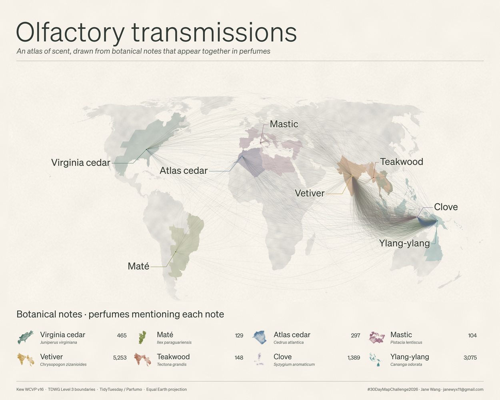

# Day 19 · Smell — Olfactory transmissions

Which plant notes appear together in perfumes, and where do those plants grow natively?



[300 DPI plate](outputs/olfactory_transmissions.png) · [Pair counts](outputs/note_pairs.csv) · [Species and counts](outputs/candidate_taxa.csv)

## Process

Each perfume’s top, heart, and base notes were unpacked from TidyTuesday’s Parfumo dataset<sup>[1](#sources)</sup>, with note positions treated equally. Note frequency was then calculated across distinct perfumes and brands.

The note vocabulary was matched against Scento’s material dictionary<sup>2(#sources)</sup> to identify botanical notes that could be linked confidently to a single plant species. “Atlas cedar,” for example, was retained, while the broader label “cedarwood” was excluded as taxonomically ambiguous.

From these matches, eight species were selected based on clear taxonomic identity, documented native ranges, sufficient representation in the perfume dataset, and geographic diversity.

For the map, each scientific name is matched to an accepted species in Kew’s World Checklist of Vascular Plants (WCVP)<sup>[3](#sources)</sup>, which lists the botanical areas where that species is native. Those area codes join to TDWG Level 3 polygons<sup>[4](#sources)</sup>, which supply the shapes to draw.

The eight selected notes were then compared within the perfume corpus. Each strand represents one perfume in which both connected botanical notes appear. A perfume containing several selected notes can therefore contribute more than one strand. Strand density reflects note co-occurrence; the paths themselves are imagined.

| Perfume note | Accepted species | Native range, abbreviated from Kew | Perfumes | Brands | Kew areas |
| --- | --- | --- | ---: | ---: | ---: |
| Vetiver | *Chrysopogon zizanioides* | NE India to Indochina | 5,253 | 1,005 | 8 |
| Ylang-ylang | *Cananga odorata* | S Indochina to Queensland | 3,075 | 777 | 12 |
| Clove | *Syzygium aromaticum* | Maluku | 1,389 | 526 | 1 |
| Virginia cedar | *Juniperus virginiana* | SE Canada, central and eastern US, Coahuila | 465 | 263 | 42 |
| Atlas cedar | *Cedrus atlantica* | N and north-central Morocco to N Algeria | 297 | 188 | 2 |
| Teakwood | *Tectona grandis* | India to Indochina | 148 | 90 | 8 |
| Maté | *Ilex paraguariensis* | Brazil to NE Argentina | 129 | 92 | 7 |
| Mastic | *Pistacia lentiscus* | Canary Islands and Mediterranean | 104 | 70 | 23 |

## Assumptions, joins and post-processing

- **Assumptions.** A listed perfume note represents a scent association. Eight specific note labels were linked to accepted plant species. Kew’s native status applies at the botanical-area scale. The analysis makes no claim about ingredient sourcing, transport, or brand origin.
- **Joins.** Normalized Parfumo notes matched Scento names or aliases. Reviewed note–species links matched exact accepted WCVP names. WCVP plant IDs linked species to native distribution records, and TDWG Level 3 codes linked those records to polygons.
- **Post-processing.** Each note counted once per perfume across top, heart, and base positions. The eight notes formed 26 observed pairs. Native polygons were simplified for display. Each species received one chosen anchor inside its range, and a fixed seed shaped the curves between anchors. Bundle size encodes co-occurrence; the path is artistic.

## Limitations

- A coloured area means Kew lists the plant as native somewhere in that botanical area. The shape can include a lot of land outside the species’ actual habitat.
- Only the reviewed note wordings count towards a species. A spelling or alias outside those rules adds nothing, so the perfume counts are lower bounds.
- Only 31,163 of the 59,281 perfumes list any pyramid notes. Pairings among the others are unknown.

## Reproduce the plate

From this folder, with Python 3.12:

```sh
# 1. Create the environment
python3 -m venv .venv
.venv/bin/python -m pip install -r requirements.txt -r requirements-map.txt

# 2. Build the database from the included data snapshot, then count the note pairs
.venv/bin/python build.py
.venv/bin/python -c "import duckdb; duckdb.connect('outputs/perfume.duckdb', read_only=True).execute(open('sql/note_pairs.sql').read())"

# 3. Render
.venv/bin/python render_ranges.py            # Olfactory transmissions
.venv/bin/python render_ranges.py --ranges   # range-only atlas, without strands
```

`build.py` checks the source manifest, runs [corpus.sql](sql/corpus.sql) and [botany.sql](sql/botany.sql), validates the counts and writes `outputs/perfume.duckdb`. Plate settings (colours, layout, type sizes and wording) live in [render_config.yaml](render_config.yaml). To download the inputs from scratch instead of using the snapshot, see [data/README.md](data/README.md).

## Sources

1. Parfumo records, collected by Olga G. and cleaned for TidyTuesday on 2024-12-10. A redistribution licence for the underlying corpus was not verified. [TidyTuesday release](https://github.com/rfordatascience/tidytuesday/tree/main/data/2024/2024-12-10)
2. Scento Perfume Database, materials, CC BY 4.0. [Scento](https://github.com/Scento-com/perfume-dataset)
3. Govaerts, R., ed. (2026). World Checklist of Vascular Plants v16, Royal Botanic Gardens, Kew, CC BY 3.0. [WCVP release](https://doi.org/10.34885/egs6-cp24)
4. TDWG World Geographical Scheme for Recording Plant Distributions, Level 3 polygons. [Pinned GeoJSON](https://github.com/tdwg/wgsrpd/blob/52da7828aba9d461dd133c27b3bd7a4407161f54/geojson/level3.geojson)

The original brand-origin question, dictionary coverage, TreeFinder ecoregions and other background are in [data/README.md](data/README.md).
