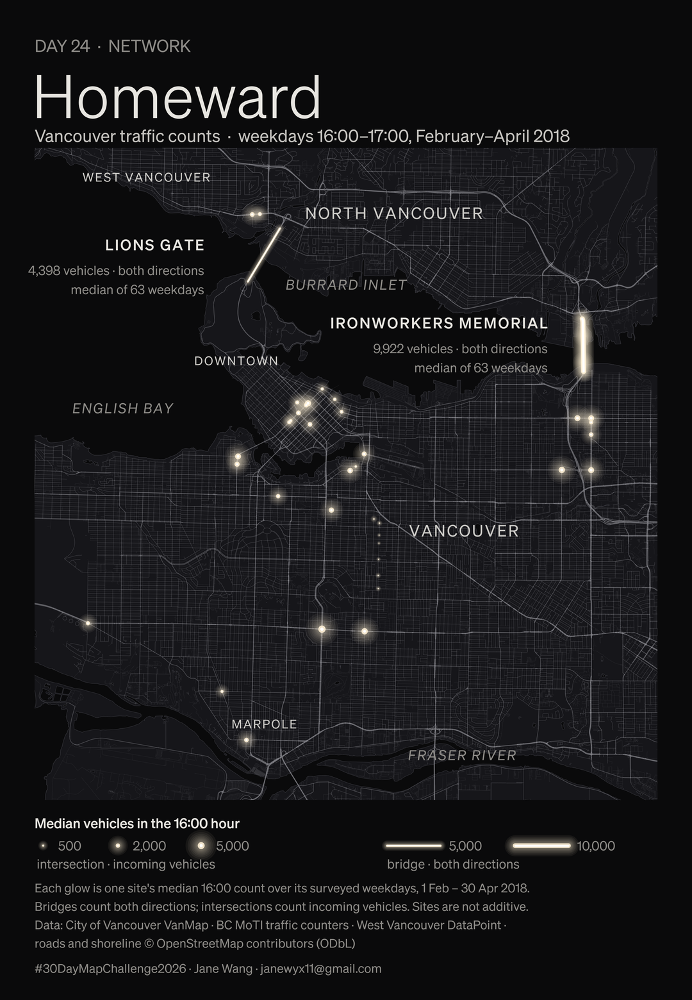

# 16:00 / Two Crossings

Can a weekday PM hour connect measured traffic volumes in downtown Vancouver, Marpole, the Lions Gate and Ironworkers crossings, and their North Shore approaches?



**Homeward** lights every site in the spring 2018 16:00 composite: 35 Vancouver intersections, two West Vancouver approaches at Park Royal and both bridge crossings. Each glow is the median count for the site's 16:00–17:00 hour across its surveyed weekdays, 1 February – 30 April 2018. Dot area scales with incoming vehicles at an intersection. Line width on each bridge deck scales with two-way vehicles at the Vancouver end. The two scales describe different counts, so read each site on its own. The basemap draws OpenStreetMap roads, shoreline and inland water. Four Vancouver sites lack catalogue coordinates. Three are placed at the City intersection points listed in the config. Boundary Road at 1st Avenue is placed where the two OSM streets meet.

```sh
.venv/bin/python scripts/render_homeward.py   # caches OSM extracts in data/raw/osm on first run
```

Settings (extent, palette, type sizes, label anchors, footer text) live in [scripts/homeward_config.yaml](scripts/homeward_config.yaml), and helpers in [scripts/homeward_functions.py](scripts/homeward_functions.py). The plate exports at 2700 × 3900 px (9 × 13 in, 300 DPI) to `outputs/homeward.png`, with a 1080 px preview.

**The broadest geographic comparison in the inventory is a February–April 2018 composite.** The 16:00–17:00 local hour covers 35 Vancouver intersections, including six Downtown sites and one in Marpole, both bridge stations, and two West Vancouver intersections near Park Royal. The 17:00–18:00 hour ties with 39 sites. Vancouver intersection surveys in this cohort run from February 6 through April 26. The West Vancouver observations were collected at Marine Drive and Park Royal on February 28 and at Marine Drive and Park Royal West on March 28. Bridge observations are available on those survey dates. The provincial archive supplies measured 15-minute turns at two immediate Lower Lynn junctions, the Mountain Highway off-ramp on June 12, 2001 and the Fern Street ramps on July 31, 2001. A survey near the Ironworkers approach from the 2018 comparison period remains missing.

A simultaneous observation is available on Wednesday, February 28, 2018, from 16:00 to 17:00.

| Site | Count during the hour | What it measures |
|---|---:|---|
| Cambie Street at West Hastings Street | 1,502 | Incoming vehicle movements |
| Lions Gate, Route 99 | 4,194 | Both bridge directions |
| Ironworkers Memorial / Second Narrows, Route 1 | 9,479 | Both bridge directions |
| Marine Drive at Park Royal | 1,691 | Incoming vehicle movements |

Marpole joins the composite through Cornish Street at Southwest Marine Drive, with 2,226 vehicles on April 19, 2018, from 16:00 to 17:00. The largest single PM snapshot by site count was April 11, 2024, with nine city intersections and both bridges. It has no Marpole or North Shore approach intersection. These rankings describe the downloaded survey cohorts. Compare bridge and intersection volumes site by site. Their counts have different denominators and can include the same vehicle at successive locations.

## Reproduce the inventory

Run from this directory with Python 3.12 and uv. The raw folder already contains the acquisition snapshot. The manifest records public GET URLs, read-only POST parameters, UTC retrieval timestamps, failures and SHA-256 hashes. The acquisition command verifies existing bytes and restores missing files when the publisher still serves the same version.

```sh
uv venv --python 3.12 .venv
uv pip install -r requirements.txt
.venv/bin/python scripts/acquire.py
.venv/bin/python scripts/run_notebook.py
```

The notebook reads the raw cache offline. Its three figures are embedded in the executed notebook. The raw publisher files stay outside Git.

## Read the tables

- Open [the executed notebook](afterglow_data_inventory.ipynb) for the source and coverage tables, date/hour rankings, figures and verdict.
- [Source inventory](data/processed/source_inventory.csv) and [coverage](data/processed/coverage.csv) distinguish indexed locations, acquired measurements, complete hours and weekday PM coverage. The municipal studies and failed downloads remain in the record.
- [Native observations](data/processed/native_observations.csv.gz) preserve turning movements and bridge road, direction and lane counts. Types of measurement overlap. Use [validated site-hours](data/processed/site_hours.csv.gz) for site totals. Site-hours count incoming vehicle turns at intersections and two-way traffic at bridges. Adding sites would count vehicles again as they travel.
- [Directional-counter observations](data/processed/directional_hourly_observations.csv.gz) contain dated, per-direction short-term midblock counts. [Permanent-counter aggregates](data/processed/permanent_hourly_aggregates.csv.gz) preserve published month, hour and weekday/weekend groups. Both have different spatial or temporal support from the intersection comparison.
- [Exact weekday overlap](data/processed/weekday_date_hour.csv), [clock-hour overlap across years](data/processed/weekday_clock_hour.csv) and [clock-hour overlap within each year](data/processed/weekday_clock_hour_by_year.csv) count distinct sites. Downtown and Marpole are included in the Vancouver column. [The 2018 candidate table](data/processed/spring_2018_candidate_site_hours.csv) retains every qualifying site-date in the selected hour, including repeat surveys.
- [Sites](data/processed/sites.csv), [modern survey inventory](data/processed/vanmap_survey_inventory.csv), [historical report inventory](data/processed/historical_report_inventory.csv) and [download manifest](data/download_manifest.csv) trace observations back to their source. Preserve leading zeros by reading site identifiers as strings.

## Sources and limits

Vancouver turn counts come from the legacy location index and VanMap attachments. The historical viewer returned HTTP 403. The acquisition uses a pinned public mirror of the original city HTML reports and a published link list. It parses the movement tables in the HTML, independently of previously derived CSV counts. The archived approach and lane fields support a conservative completeness check. [City intersection index](https://opendata.vancouver.ca/explore/dataset/intersection-traffic-movement-counts/) · [VanMap traffic layers](https://maps.vancouver.ca/server/rest/services/VanMapViewer/Traffic_and_Transportation/MapServer) · [Archived original HTML](https://github.com/e-n-f/vancouver-traffic-counts/tree/cf7880a1a65fe2b9ae262de228c33e767f8a3b63) · [Report-link list](https://github.com/erfanhajibandeh/tmc-scraper/tree/678eb41cbf130e901a9f7a1ab3aa92c906944249/data/scraped) · [City open-data licence](https://opendata.vancouver.ca/pages/licence/)

The provincial program supplies crossing measurements at the Vancouver end of each bridge. The station page describes the south end of Second Narrows, while the diagram and monthly volume report call it the east end along Route 1. The directional labels in each report are preserved. [Lions Gate](https://tradas.th.gov.bc.ca/tradas.asp?loc=P-15-1NS) · [Second Narrows](https://tradas.th.gov.bc.ca/tradas.asp?loc=P-15-2EW)

West Vancouver publishes quarter-hour movements and peak-period summaries through DataPoint. The District of North Vancouver publishes Marine Drive peak-period turns without exact survey times, and timed counts at Mountain Highway and E 18th Street, upstream of Lower Lynn. The City of North Vancouver's Cloverley study describes daily midblock volumes. The Lower Lynn strategy includes adjusted or modeled volumes. [West Vancouver traffic data](https://westvancouver.ca/services/transportation/traffic-data) · [DNV Road Safety Plan, Table C-1](https://docs.dnv.org/documents/road-safety-plan.pdf) · [Mountain Highway assessment](https://docs.dnv.org/documents/mountain-highway-transportation-assessment-2023.pdf) · [Lower Lynn strategy](https://docs.dnv.org/documents/lower-lynn-transportation-strategy-2011.pdf) · [Cloverley study](https://www.cnv.org/-/media/city-of-north-vancouver/documents/traffic-calming/cloverley-traffic-calming-plan-report-1.pdf)

Clock times use the published local survey labels. The weekday screen includes holidays. Published zeros survive where a report documents the survey window. Missing intervals, unresolved geometry and unknown survey dates remain missing. The provincial Traffic Data Map supplies station points for both bridges. These are catalogue locations. The station diagrams identify the road and detector arrangement. [BC Traffic Data Map](https://twm.th.gov.bc.ca/?c=tdp)
