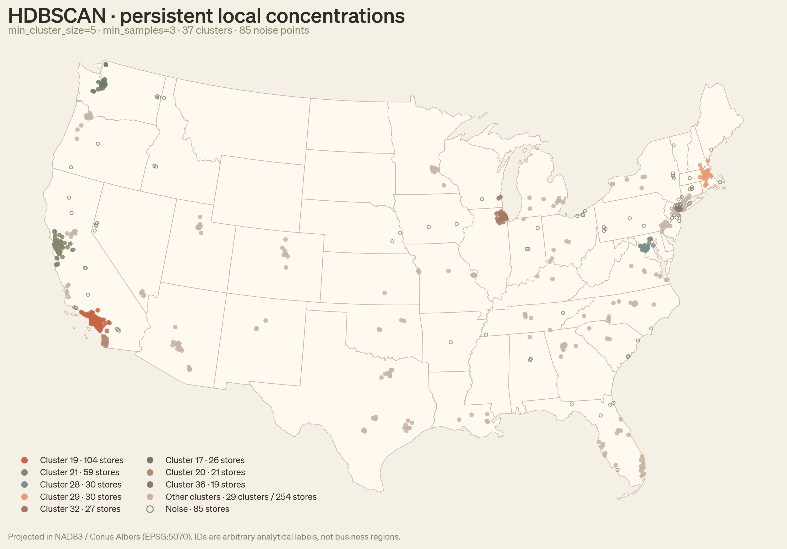
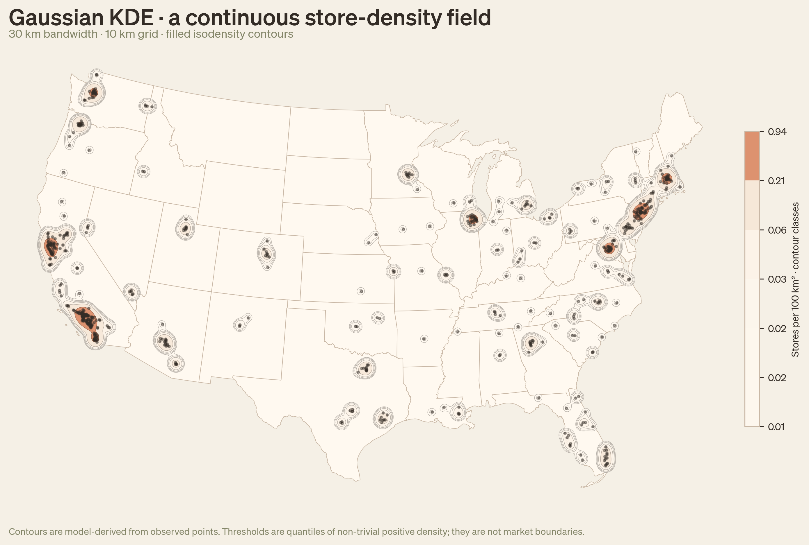

# Day 04 — Clusters: Trader Joe's

This project asks: **What spatial structure is visible in Trader Joe's store locations across the contiguous United States, and how does that structure change when represented as discrete clusters versus a continuous density field?** Using 655 observed store locations, the notebook compares two exploratory views of the same distribution. These patterns are analytical representations—not Trader Joe's operating regions, market boundaries, or evidence of demand.

## HDBSCAN spatial clusters

HDBSCAN identifies persistent, density-based groups without requiring a preset number of clusters or forcing every store into one. With `min_cluster_size=5` and `min_samples=3`, the analysis finds 37 clusters and leaves 85 stores as noise. The eight largest clusters are shown individually, the remaining valid clusters in warm taupe, and unassigned stores as hollow sage circles. Cluster IDs are arbitrary analytical labels.

## Gaussian KDE store-density field

Gaussian kernel density estimation (KDE) presents store concentration as a continuous surface rather than assigning memberships. The map uses a 30 km bandwidth on a 10 km grid and expresses the smoothed result as stores per 100 km². Its contours reveal local and regional concentrations, but they are model-derived isodensity bands—not market boundaries.

For the data preparation, parameter choices, method explanations, limitations, bandwidth comparison, and combined HDBSCAN-informed KDE, see the full [`trader_joes_clusters.ipynb`](notebooks/trader_joes_clusters.ipynb) notebook.
