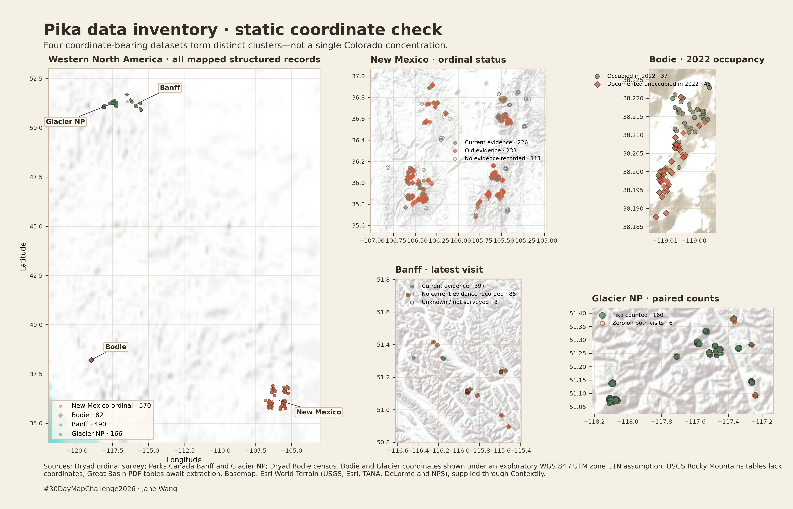
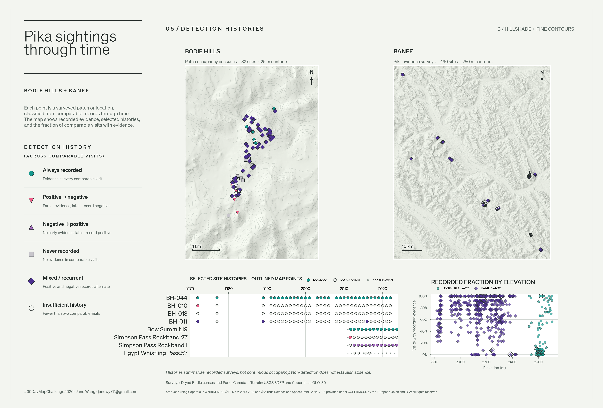
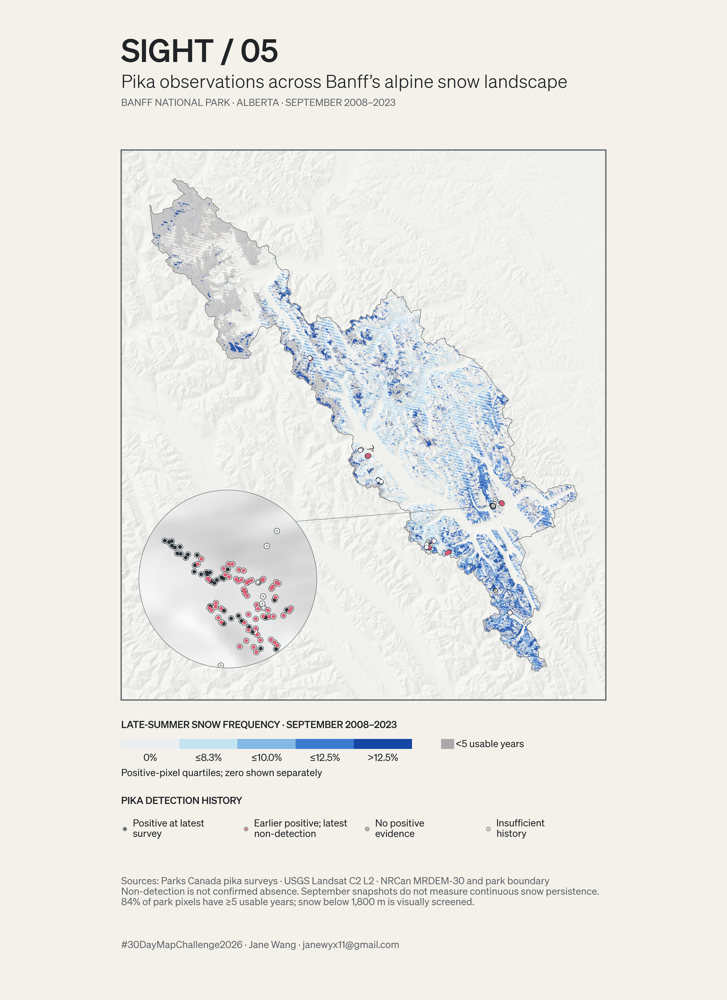

# Day 05 · Sight: pika observations

An exploration of American pika survey records, mountain terrain and sampled September snow and ice. The final Banff map shows pika detection histories alongside a Landsat-derived snow-frequency layer; it does not establish that snow conditions caused a change in pika occurrence.

## Geographic overview



The overview compares four datasets with different sampling designs: New Mexico patch evidence, Banff survey visits, Glacier point counts, and the Bodie Hills patch census. Their status categories should not be treated as interchangeable.

## Terrain experiment



An exploratory hillshade and contour treatment, produced before narrowing the final study to Banff.

## Banff: pika observations and late-summer snow



One September Landsat date per year was selected for the best usable park coverage, 2008–2023. Frequency is the proportion of **usable selected annual observations** flagged as snow or ice, not the duration of snow cover. The map greys pixels with fewer than five usable years; 84% of park pixels meet that threshold. Snow colouring below 1,800 m is visually screened. Colours divide nonzero pixels into quartiles, with zero shown separately. Water was not separately masked: the snow flag comes from the Landsat QA classification. Non-detection does not confirm pika absence. Many survey symbols overlap at park scale; the circular inset uses the released coordinates without displacement.

## Open the notebook

From this folder, install dependencies and start Jupyter:

```sh
python -m pip install -r requirements.txt
jupyter notebook notebooks/pika_sight.ipynb
```

The notebook displays the saved PNGs; it does not download data or regenerate the maps. The display script reads image paths and styling settings from [config/sight.json](config/sight.json). The PNGs are finished images, so changing palette entries in the configuration does not recolour them.

## Data

[Combined observations](published/pika_observations_combined.csv) has 8,796 rows: 5,191 Banff visits, 329 Glacier visits, 2,706 Bodie patch-years, and 570 New Mexico patches. It retains source-specific fields and unknown or `not censused` values. Rows are not independent populations, dates and coordinates may be missing, and no missing record should be interpreted as an absence. Released UTM datums are not documented in these source tables; Glacier's UTM zone is also unstated.

The two GeoTIFFs used by the Banff plate are included in [`data/banff_geospatial/`](data/banff_geospatial/):

- `banff_mrdem_dtm_30m_26911.tif`: NRCan bare-earth terrain, 30 m, EPSG:26911, heights in metres relative to CGVD2013. Approximately 82 MiB.
- `banff_late_summer_snow_frequency_30m.tif`: USGS Landsat 5/7/8/9 Collection 2 Tier 1 Level-2 QA-derived frequency. Bands are frequency × 10,000, snow/ice years, and usable years; nodata is 65,535. Approximately 3.7 MiB.

The DEM is below GitHub's 100 MB individual-file limit but makes the repository much larger. The TIFFs are prepared derivatives, not the original national DEM or Landsat scenes.

The combined CSV can be rebuilt with `python scripts/prepare_pika_observations.py` after placing the four original downloads in the matching `data/` locations. The Bodie workbook requires `openpyxl`. Source downloads and other working files are intentionally excluded by the folder's `.gitignore`; the included notebook needs only the committed PNGs and configuration.

## Sources and reuse

- Parks Canada: [Banff alpine pika haypile surveys](https://open.canada.ca/data/en/dataset/da79ab09-fc92-47c0-8574-0db760bcb564) and [Glacier pika point counts](https://open.canada.ca/data/en/dataset/3d0296dc-2a45-4fea-83c2-b1dd71e5091a), [Open Government Licence – Canada](https://open.canada.ca/en/open-government-licence-canada).
- Peacock et al., [Bodie Hills pika dataset, Dryad](https://doi.org/10.5061/dryad.51c59zwbd); Westover et al., [New Mexico pika patch dataset, Dryad](https://doi.org/10.5061/dryad.z612jm6n0). Dryad data are released under CC0; please cite the datasets.
- [NRCan MRDEM-30](https://open.canada.ca/data/en/dataset/18752265-bda3-498c-a4ba-9dfe68cb98da) and [Banff National Park legislative boundary](https://open.canada.ca/data/en/dataset/9e1507cd-f25c-4c64-995b-6563bf9d65bd), Open Government Licence – Canada.
- USGS Landsat Collection 2: [quality assessment bands](https://www.usgs.gov/landsat-missions/landsat-collection-2-quality-assessment-bands). The terrain preview also uses [USGS 3DEP](https://www.usgs.gov/3d-elevation-program) and Copernicus DEM data; Copernicus WorldDEM-30 © DLR e.V. 2010–2014 and © Airbus Defence and Space GmbH 2014–2018, provided under COPERNICUS by the European Union and ESA; all rights reserved.
